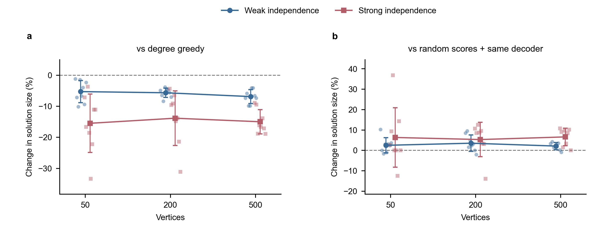

# 第一轮合成超图实验

后续采用作者公开网络与退火配置的结果，单独记录在 [补充实验报告](public-preset-20261018.md)。本页只汇总两秒目标预算的小模型批次。

实验日期：2026-10-18。所有记录包含具体解并经过独立可行性检查。

已完成 48/48 个实例与定义组合，核验 576 条方法运行记录。

## 实验设置

24 张固定合成超图：节点数 50、200、500；超边大小 3、5；超边数为节点数的 2 倍或 4 倍；每种配置两个生成种子。每张图分别研究强、弱两种定义。每个随机方法使用三个种子，神经网络不跨实例共享训练。

神经方法与随机重启的搜索目标为每次约 2 秒。神经方法预算包含模型与结构构建和训练，最后预测／后处理另计；随机重启在完整一次解码后检查时限。HiGHS 与 SCIP 的限制为求解器内部 2 秒，其建模及初始解开销另计。以保存的实际总耗时为准，不能称为严格等时实验。

SCIP 显式使用低度贪心初始解、单线程。HiGHS 没有注入该初始解。单次随机分数对照与神经方法采用完全相同的解码器，用来检查训练是否提供额外排序价值；该对照不使用满 2 秒。

## 按定义汇总

### 弱独立集

共 24 个匹配实例，其中 6 个有求解器证明最优值。

神经方法相对低度贪心的实例平均解大小差异为 -5.93%；胜／平／负为 0 / 0 / 24。

相对单次随机分数＋同一后处理，平均差异为 +2.71%。网络原始阈值解可行率为 79.2%，空集比例为 31.9%。

| 方法 | 相对本批最好可行解的平均比例 | 平均总耗时（秒） |
|---|---:|---:|
| 低度优先贪心 | 0.935 | 0.089 |
| HiGHS（限时） | 0.732 | 1.786 |
| SCIP（贪心初始解） | 0.990 | 1.278 |
| 随机分数＋同一后处理 | 0.857 | 0.064 |
| 限时随机重启＋同一后处理 | 0.929 | 2.025 |
| HGNN+＋PUBO＋后处理 | 0.880 | 2.063 |

### 强独立集

共 24 个匹配实例，其中 8 个有求解器证明最优值。

神经方法相对低度贪心的实例平均解大小差异为 -14.77%；胜／平／负为 0 / 0 / 24。

相对单次随机分数＋同一后处理，平均差异为 +6.08%。网络原始阈值解可行率为 100.0%，空集比例为 95.8%。

| 方法 | 相对本批最好可行解的平均比例 | 平均总耗时（秒） |
|---|---:|---:|
| 低度优先贪心 | 0.906 | 0.110 |
| HiGHS（限时） | 0.907 | 1.371 |
| SCIP（贪心初始解） | 0.966 | 1.265 |
| 随机分数＋同一后处理 | 0.728 | 0.146 |
| 限时随机重启＋同一后处理 | 0.897 | 2.067 |
| HGNN+＋PUBO＋后处理 | 0.770 | 2.105 |

## 解释范围

HiGHS 在部分较大实例的两秒时限内只找到包含 1—2 个节点的初始可行解。该结果反映短时求解行为，不能据此声称神经方法优于精确优化算法；同时保留带贪心初始解的 SCIP 对照。

试跑目录与三步接口检查目录保留用于追溯，但不混入本页固定协议的汇总；它们使用的基线集合或迭代预算不同。没有根据结果优劣排除本批预设实例。

图中点为实例内三种子的均值对应的相对差异，线为同一规模下八个配置与实例组合的均值，误差条为描述性标准差。左图与低度贪心比较，右图与单次随机分数加相同后处理比较。绘图源码及完整源数据与结果共同保存。

先在每个实例内对三个随机种子取均值，再对匹配实例汇总；不把重复训练种子当成独立超图。不同稠密度在相同生成种子下可能共享部分超边，汇总只作描述性比较，不报告显著性检验。

表中的最好可行解来自本批所有方法；没有最优性证明时，它不是数学最优解。原始解可行率必须结合空集比例解读，空集总是可行，但没有求解质量。

本轮固定使用 32 维特征、两层 HGNN+、学习率 0.01、惩罚系数 2 和最终二值化权重 0.1；不是经过系统调优的最佳 BIPNN 配置，也不代表原论文的完整复现。全部配置与失败表现均保留。

PySCIPOpt 对当前链接的 SCIP 版本给出推荐版本不匹配提醒；小实例与枚举对照通过，但后续正式实验应固定匹配版本。
